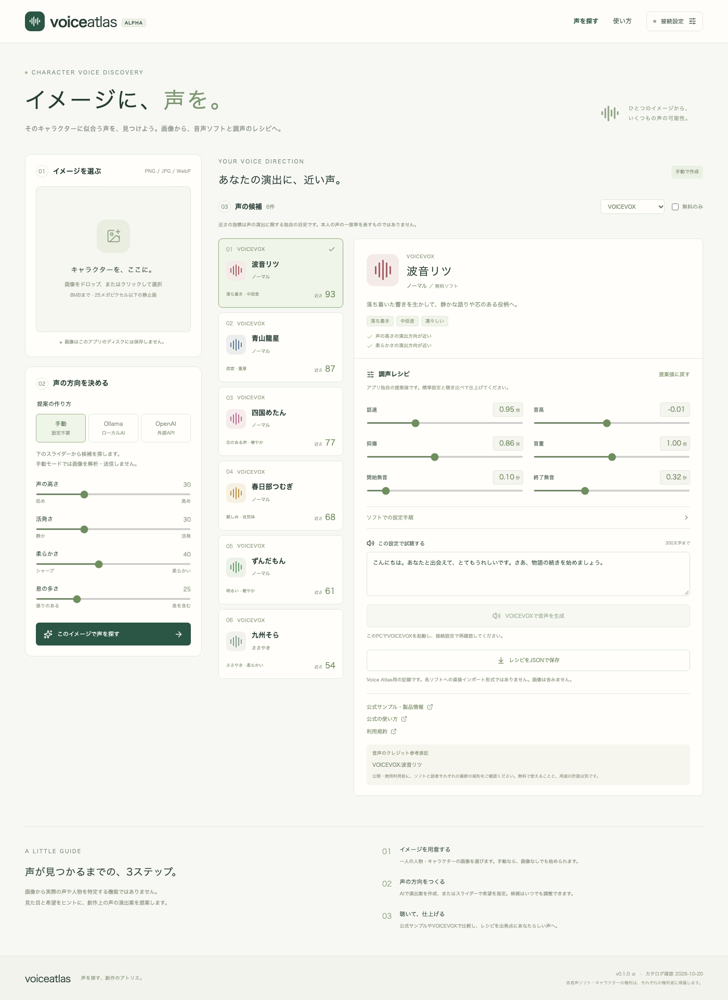

# Voice Atlas — イメージに、声を。

キャラクターや人物の画像、または作者が書いたキャラクター設定から、創作上の声の演出案を作り、既存の音声読み上げソフト・話者・調声レシピを探すアプリです。開発初期からGitHubで公開する、実験段階のオープンソースプロジェクトです。

**画像から実際の声や人物を特定するものではありません。** 視覚的な要素とユーザーの演出希望を参考に、試聴して選ぶための出発点を提案します。



詳しい操作方法は[操作マニュアル](docs/manual.md)を参照してください。

## できること

- **Irodori v4.1の生成済み声を比較**：手元の検証で作った老魔術師・企業幹部・男性AIの基準音声と別台詞を試聴し、作品の候補として保存。キャラクターごとの聴き比べ・比較メモ・仮配役を作品に記録し、台本の発話者からも仮配役の検証音声を確認。検証WAVはブラウザ内へ保存

- **初回試聴と接続診断**：VOICEVOX・AivisSpeechの未接続と利用可能な話者なしを区別し、APIキーなしで最初の音声生成・再生・WAV保存まで案内
- **実機評価の比較**：共通6文の評価ランを最大4件読み込み、音声・初回と2文目以降の待ち時間・機器と生成条件を比較。聴取メモ・3項目の評価・採用判断を比較記録JSONで保存・復元し、元のWAVを再接続できます。
- **制作の入口**：ページ上部に現在の作品名と保存状態を表示。「声を探す → 配役を決める → 台本を作る」のガイドから各工程へ直接移動し、必要な欄を開きます。編集中の内容を保持したまま、作品の管理・保存にも移動できます。
- **作品をまとめて保存・復元**：声探し・製品比較・採用声・設定比較・キャスティング表・編集中の台本・台本ライブラリを作品JSONにまとめ、ブラウザ保存と別環境への復元に対応。未保存表示・復元前の確認・容量不足時の保持・別タブの変更検出を提供
- **複数作品のライブラリ**：最大20作品を検索・新規作成・切り替え・名前変更・複製・削除。未保存変更は保存・破棄・キャンセルを選択でき、最後に開いた保存済み作品を再開
- **台本の読み上げ文と作品別辞書**：台本の表示を保ったまま行ごとの読み上げ文を指定。名前・地名・用語の読みを最大100件登録し、適用前に対象行を確認。手動の読み上げ文を優先
- **台本音声の保存と再利用**：保存した作品の台本音声をブラウザ内に保存し、再起動後に作品・行・読み上げ文・話者・調声値が一致する音声を再利用。生成時の情報を保持し、容量不足時にも既存音声を維持
- **音声付き作品アーカイブ**：作品設定、条件が一致する保存済み台本音声、選択したIrodori候補の保存済みWAVを、一つの`.vaarchive`ファイルで持ち運び。内容確認後に新しい作品として追加し、エンジン未接続でも音声を再利用。破損・容量不足・別タブ更新時は元の作品を保持
- PNG・JPEG・WebPの画像を読み込み（8MB、25メガピクセル以下）
- 画像解析の説明に誤りがあれば、結果欄から作者の訂正をキャラクター設定へ反映し、確認・再同意して再解析
- **Ollama**のローカル画像対応モデル、または任意設定の**OpenAI Responses API／Anthropic Claude API／Gemini API／DeepSeek API**で声の演出案を作成
- 画像なしでも、役柄・性格・背景・演技指示などの設定テキストから声の演出案を作成（2000文字まで）。画像を併用する場合も作者の設定を優先
- AIを使わず、声の高さ・活発さ・柔らかさ・息の多さを手動指定
- 公式情報を参照した3ソフト・16話者・24候補（話者とスタイルの組み合わせ）のカタログから比較
- ソフト・無料ソフト・「試聴可能のみ」で絞り込み
- キーボード・タッチ操作に対応した、4軸と調声値のツールチップヘルプ
- **VOICEVOX**の話速・音高・抑揚・音量・開始無音・終了無音を提案・調整
- 接続中のVOICEVOXから話者とスタイルを照合し、設定を反映して試聴・WAV保存
- VOICEVOXの2候補を同じセリフで比較試聴し、候補ごとの調整値・生成音声を保持
- **AivisSpeechのモデル・利用条件**：候補の近くでモデル名・版・制作者・取得できた利用条件と関連リンクを表示。現在・保存時・試聴音声に対応する情報を区別し、確認日時付きで保存
- **製品比較の履歴集計と再利用**：複数の比較セッションを重複除去して集計（最大1000件）。製品・話者・採用結果・理由等で絞り込み、JSON/CSV保存、採用した声と当時の比較条件を比較欄へ復元
- **キャラクターの採用声ライブラリ**：比較で採用した声にキャラクター名・設定名・メモを付けて登録（合計100件）。名前・製品で検索し、候補A/Bへ読み込み。ブラウザ内の保存と専用JSONの入出力に対応
- **採用声から別設定を作成**：ライブラリの声を調整し、元の設定と同じセリフで比較。1候補の音声生成後、新しい設定名・変更理由・派生元を付けて保存し、元の登録を保持
- **保存した設定の比較**：ライブラリの2件を同じセリフで比較し、調声値の違いを確認。使用する設定・場面・理由と比較時の設定を記録し、ブラウザ保存・専用JSONでの保存と復元に対応。同じ話者の調声違いも比較可能
- **キャスティング表**：比較で選んだ設定を作品・キャラクター・使用場面ごとに確定し、検索・候補への呼び出し・専用JSONでの保存と復元に対応
- **台本の試聴**：確定した声を20行までの台本に割り当て、行順の生成・連続試聴・行別WAV保存に対応。台本と割り当てた設定をブラウザ・専用JSONで保存・復元
- **台本ライブラリ**：作品・場面ごとに最大30台本を保存・検索・複製。未保存の変更を確認して切り替え、ライブラリ全体のJSON保存・復元に対応
- **台本の一括取り込み**：「名前：セリフ」のテキストとUTF-8 CSVから取り込み。作品・場面で声を絞り、完全一致の自動対応・同名候補の選択・プレビュー修正・未保存確認に対応
- **台本発話者の編集**：行ごとの発話者名の修正と同名行の一括改名に対応。名前だけを変えても生成済み音声は保持し、Irodori仮配役の表示を更新
- **声の一括差し替え**：発話者の全行または特定設定を使う行を確認して差し替え。ほかの行の音声を保持し、変更対象だけを再生成。直前1回の変更前後を比較試聴し、元の設定・生成済み音声に戻せます
- **場面別設定の呼び出し**：キャスティング表の作品・キャラクター・使用場面から設定を探し、台本の選んだ行だけに適用。別作品の同名人物を分け、読み上げ文・対象外の音声を保持。変更行だけの生成と直前の取り消しに対応
- **生成の進捗と再試行**：対象行ごとの生成中・成功・失敗・中止・未処理と試行回数を表示。成功した音声を保持し、失敗行だけの再試行と未完了対象の再開を選択。条件変更や削除後の古い記録からの再試行を防止
- **台本全体のWAV出力**：全行を48kHz・16bit・モノラルのWAVに結合。長い音声の変換中も中止操作に対応。行間の無音を指定でき、各行の時刻・設定・今回の生成情報を出力記録JSONに保存
- **製品横断の比較**：VOICEVOX・AivisSpeechとElevenLabsを選び、製品固有の調声・比較試聴・採用理由の記録・比較セッションJSONでの保存と復元に対応（候補200件、評価100件）。ElevenLabsはAPIキーが必要で、セリフをクラウドへ送信します。
- 編集中の設定と、声の方向を作ったときの設定を区別して保存・復元
- 採用する声・選択理由と比較時の条件を記録（最大100件）。評価時のスコア・順位・推薦とカタログの版・取得できたエンジン情報も保持
- 複数のJSONから評価履歴を重複除去して集計（最大1000件）。評価時・現行スコアの違い、評価時の版や理由で絞り込み、JSON・CSVで保存
- **COEIROINK・A.I.VOICE2**の公式情報付き手動調整ガイド
- 選んだ話者・設定・比較記録を画像なしのJSONレシピとして保存・復元（保存はv3、旧形式v1・v2も読み込み可能）

声の特徴・順位・調整値はアプリ独自の編集上の提案です。声の類似性を測定した値や、本人の声の一致率ではありません。無料ソフトのフィルターは用途の許諾や商用利用の可否を保証しません。

「入力するもの」で **設定テキストのみ** を選び、役柄や話し方を書いてAIを選ぶと、画像なしで演出案を作れます。設定テキストは作者の創作意図として扱います。手動モードでは文章を自動解釈せず、4軸を自分で指定します。設定・補足はJSONと評価記録にも含まれます。

## 起動

Node.js **24 LTS推奨**（22.12以降）とnpmが必要です。

```sh
git clone https://github.com/kenken-trpg/voice-atlas.git
cd voice-atlas
npm ci
npm run dev
```

**http://127.0.0.1:3210** を開きます。手動モードはAPIキー不要です。画像や演出の補足をAIで処理する場合は、次の接続を設定してください。

### Ollamaで画像を解析する

[Ollama](https://ollama.com/)をインストールして起動し、画像入力対応のローカルモデルを用意します。例：

```sh
ollama pull gemma3:4b
```

モデルの実行にはモデルに応じたメモリーと空き容量が必要です。モデルをすでに用意している場合は `.env.example` を `.env` にコピーし、`OLLAMA_MODEL` を変更できます。画像はローカルOllamaへ送られます。`:cloud` などクラウドモデルは対象外です。ローカルOllamaが信頼できる構成で動いていることを前提にしています。

### OpenAIで画像を解析する（任意）

`.env.example` を `.env` にコピーし、サーバー側で設定します。

```dotenv
OPENAI_API_KEY=ご自身のAPIキー
OPENAI_MODEL=gpt-4.1-mini
```

サーバーを再起動し、画面でOpenAIを選んで、画像・補足の送信に同意すると利用できます。APIの利用料は利用者のアカウントに発生します。画像入力と構造化出力に対応し、ご自身のAPIプロジェクトで利用できるモデルを指定してください。接続表示はAPIキーの設定有無であり、利用権限や残高の検証ではありません。

キーはブラウザーへ渡しません。画像は向き補正・縮小・メタデータ除去を行いJPEGに変換してから送信します。Responses APIには `store: false` を指定しますが、プロバイダー側の保持や処理条件については[OpenAIのデータ管理説明](https://developers.openai.com/api/docs/guides/your-data)を確認してください。

### Anthropic Claudeで画像を解析する（任意）

`.env` に次の2項目を設定します。まだファイルがない場合は `.env.example` を `.env` にコピーしてください。既存の `.env` は上書きせず、追記・編集します。

```dotenv
ANTHROPIC_API_KEY=ご自身のAnthropic APIキー
ANTHROPIC_MODEL=claude-sonnet-5-5
```

サーバーを再起動し、画面の「提案の作り方」で **Claude** を選びます。画像と補足のAnthropicへの送信に同意してから解析してください。接続設定にはキーの設定有無とモデル名を表示します。表示はキーの設定確認であり、認証・利用権限の検証ではありません。

キーはサーバー側だけで管理し、ブラウザーやJSONレシピへ渡しません。API利用料は利用者のAnthropicアカウントに発生します。ClaudeのWeb版の契約とは別に、Claude APIを利用できるキーが必要です。

[Anthropic公式の画像入力仕様](https://platform.claude.com/docs/en/build-with-claude/vision)と[構造化出力仕様](https://platform.claude.com/docs/en/build-with-claude/structured-outputs)に従い、JPEG画像と補足をMessages APIへ送信します。Claude用スキーマでは未対応の範囲・文字数制約を説明へ移し、応答をアプリ側で元の制約に沿って再検証します。画像入力と構造化出力に対応し、ご自身のアカウントで利用できるモデルを `ANTHROPIC_MODEL` に指定してください。

### Google Geminiで画像を解析する（任意）

`.env` に次の2項目を設定します。ファイルがない場合は `.env.example` を `.env` にコピーしてください。既存の `.env` には追記・編集し、上書きしないでください。

```dotenv
GEMINI_API_KEY=ご自身のGemini APIキー
GEMINI_MODEL=gemini-3.8-flash
```

サーバーを再起動し、画面の「提案の作り方」で **Gemini** を選択します。画像と補足のGoogleへの送信に同意してから解析してください。キーはサーバー側で管理し、ブラウザーやJSONレシピには含めません。接続設定の表示はキーの設定有無であり、認証・利用権限・利用枠の検証ではありません。

キーは [Google AI Studio](https://aistudio.google.com/apikey) で用意できます。利用枠・料金・データの取り扱いは、ご自身のGoogle APIプロジェクトと利用プランの条件に従います。[Gemini APIの利用規約](https://ai.google.dev/gemini-api/terms)を確認してください。Geminiアプリの契約とは別に、Gemini APIで使用できるキーが必要です。

[公式APIリファレンス](https://ai.google.dev/api/generate-content)に従い、画像をJPEGへ再エンコードして `generateContent` に送り、構造化された演出案を取得します。画像入力・構造化出力に対応し、ご自身のプロジェクトで利用可能なモデルを `GEMINI_MODEL` に指定してください。ブロック・出力途中での終了・不正応答はエラーとして表示し、不完全な提案を保存しません。

### DeepSeekで画像を解析する（任意）

`.env` に次の2項目を設定します。まだファイルがない場合は `.env.example` を `.env` にコピーしてください。既存の `.env` は上書きせず、追記・編集します。

```dotenv
DEEPSEEK_API_KEY=ご自身のDeepSeek APIキー
DEEPSEEK_MODEL=deepseek-flash
```

サーバーを再起動し、画面の「提案の作り方」で **DeepSeek** を選びます。画像・設定・補足の送信に同意してから解析してください。キーはサーバー側だけで管理し、ブラウザーや保存レシピには含めません。接続表示はキーの設定有無であり、認証・利用権限・残高の検証ではありません。API利用料はご自身のDeepSeekアカウントに発生します。

[DeepSeek公式の画像入力仕様](https://api-docs.deepseek.com/guides/vision/)と[Responses API仕様](https://api-docs.deepseek.com/guides/responses_api/)に従い、画像をJPEGへ再エンコードして送信します。標準の `deepseek-flash` は画像入力に対応しています。モデルを変更する場合は画像入力・構造化出力への対応を確認してください。形式が合わない応答は1回だけ自動再試行し、その分にもAPI利用料がかかる場合があります。完了しなかった応答や、再試行後も形式が合わない応答は採用しません。失敗時のサーバーログには検証段階と項目名だけを記録し、APIキー・画像・応答本文は記録しません。

### VOICEVOXで試聴する（任意）

このPCで[VOICEVOX](https://voicevox.hiroshiba.jp/)を起動します。標準接続先は `http://127.0.0.1:50021` です。画面の「接続設定」で接続を再確認してください。

接続確認時に話者名とスタイル名をエンジンの `/speakers` と照合し、候補カード・調声詳細・比較欄に「試聴可能」「未導入」「未接続」を表示します。同じ話者でもスタイルごとに判定します。「試聴可能のみ」で、このPCのVOICEVOXで試聴できる候補に絞れます。候補一覧の「接続を再確認」で、エンジンの起動・音声ライブラリの追加後に更新してください。COEIROINK・A.I.VOICE2は「アプリ内試聴対象外」と表示します。

未導入・未接続・確認中は音声生成を無効にします。調整とJSON保存・復元は可能で、比較候補や調整値は接続状態が変わっても保持します。「試聴可能のみ」は現在の接続に対する表示条件として扱い、JSONには保存せず、レシピ復元時には解除します。生成時にも最新の話者・スタイルを再確認し、数値の話者IDは固定しません。状態表示は直前の接続確認結果で、音声品質やその後の接続を保証するものではありません。未接続時は公式サンプルで比較できます。

COEIROINK・A.I.VOICE2の自動試聴と数値出力は初期版の対象外です。VOICEVOXの設定値を別ソフトへそのまま転用しないでください。

### ElevenLabsで比較試聴する（任意）

サーバーの `.env` に `ELEVENLABS_API_KEY` を設定し、サーバーを再起動します。キーはブラウザーや作品データへ保存しません。比較画面でElevenLabsの声を検索し、利用できるモデルを選んで候補へ追加できます。

ElevenLabsで試聴すると、入力したセリフが外部APIへ送信され、ElevenLabsアカウントの利用枠を消費します。生成操作の前に送信先を確認してください。音声出力には `pcm_22050` を使うため、契約プランやAPIキーの権限によっては生成できない場合があります。初版は台本の一括生成、音声複製、Voice Designには対応しません。

声を検索し、合成モデルを明示的に選んでから比較候補へ追加してください。日本語対応モデルを先に表示します。モデルごとに対応する調声だけを表示し、生成結果は22,050Hz・16bit・モノラルのWAVとして再生・保存できます。声・モデルの一覧は30秒間共有し、連続操作による取得をまとめます。認証・利用権限・利用枠・入力条件のエラーを表示し、音声生成の自動再試行はしません。比較セッション、評価JSON/CSV、採用声ライブラリ、作品JSONには声ID・モデルID・調声を保存します。

検索結果はカードで表示し、声の種別・追加状況で絞り込み、名前順で並べ替えられます。検索欄ではEnterキーでも検索できます。モデル選択時には対応言語、この画面とモデルそれぞれの入力上限、使える調声を表示します。「追加したElevenLabsの比較候補」では声の名前・モデル名で検索し、A/Bへの切り替えや候補の削除ができます。比較中の候補を削除すると残った候補でA/Bを調整し、その候補の調声・試聴音声だけを外します。記録済みの評価と採用声ライブラリは保持します。

接続と声・モデルの一覧だけを確認する場合は `npm run probe:elevenlabs` を実行します。実機評価は `npm run probe:elevenlabs -- --generate --voice-id VOICE_ID --model-id MODEL_ID --output .local-artifacts/elevenlabs/run-1` で共通台詞6文を送信します。この操作は利用枠を消費します。新しい出力先へWAV、待ち時間、サイズ、生成条件、失敗箇所を保存します。詳細は `npm run probe:elevenlabs -- --help` で確認できます。

## プライバシーと保存

- 手動モードでは画像をサーバーへ送信しません。
- AIによる演出案の作成時は、選択した解析先にだけ入力を送信します。「画像と設定」では画像・キャラクター設定・補足、「設定テキストのみ」では設定・補足を送り、読み込み済みの画像も送信しません。設定や補足の編集・入力元の切り替えで外部APIへの同意を解除します。
- サーバーは画像・生成音声・補足・解析結果をディスクやデータベースへ保存しません。画像・一時的な解析結果と未保存の音声は再読み込みで消えます。明示的に保存した作品・声ライブラリ・台本等の設定と文章、および保存操作を行った台本音声はブラウザ内に残ります。
- 試聴のセリフ・調整値はローカルVOICEVOXへ送信します。
- JSON/WAVの保存は利用者がボタンを押した場合のみです。JSONに画像・APIキーは含みませんが、セリフやAIが作成した設定ガイドは含まれます。
- 作品JSONにはキャラクター設定・演出の補足・採用理由・表示用のセリフ・読み上げ文・読み方辞書が含まれます。画像・音声・APIキー・一時的な解析結果・履歴集計欄・未登録フォームの入力は含めません。ブラウザ内では最大20作品を扱います。音声のブラウザ保存は作品JSONと別で、1行20MiB・1作品64MiB・全作品128MiBまでです。別のブラウザへ音声も移す場合は音声付き作品アーカイブを使います。現在の未保存の試聴音声は含めず、先にブラウザへ音声を保存してください。
- 比較評価の理由・評価時のセリフ・調整値もJSONに含みます。JSONの読み込みはブラウザー内で処理し、サーバーへ送信しません。生成音声はJSONには含まず、復元後に再生成します。
- 「評価記録をまとめる」では、現在の比較記録や複数JSONから評価履歴だけを追加できます。作業中の声の設定を置き換えません。集計は再読み込みで消えるため、残す場合は集計JSONを保存してください。CSVには絞り込み結果の理由・セリフ・比較条件・現行スコアを含みます。
- 画像や補足をアプリのログに出力しません。`.env`・生成物・テスト画像・依存フォルダーはGit対象外です。
- 外部フォント・アクセス解析・CDNの実行時読み込みはありません。

この初期版は**利用者自身のPCで使うWebアプリ**です。サーバーは `127.0.0.1` にバインドし、別サイトからのAPI呼び出しを拒否します。インターネット公開用の認証・利用制限は未実装です。GitHubでのソース公開と、アプリサーバーの一般公開は別の作業です。

## 開発と検証

```sh
npm run format:check
npm run check
npx playwright install chromium
npm run test:e2e
```

ビルドした画面を使う場合：

```sh
npm run build
npm start
```

API/推薦テストと、デスクトップ・スマートフォンでのブラウザーテストを用意しています。AI・音声エンジンとの通信は自動テストでモックし、有料APIの呼び出しやモデルダウンロードは行いません。実機での品質は別途、モデル・エンジンを起動して検証してください。

DeepSeekの画像解析は `npm run evaluate:vision -- --run` で、対象なし・1人・2人の画像を実APIで確認できます。1ケースだけ確認するには `--case no-subject`、`--case single-subject`、`--case two-subject` を指定します。任意の画像を加える場合は `--image /path/to/image.png` を指定します。実行するとAPI利用料が発生します。評価結果は標準出力だけに表示し、画像やAPIキーを保存しません。npmは実行コマンドに含まれる画像パスを画面に表示するため、パスを表示したくない場合は `node --import tsx server/vision-evaluation.ts --run --image /path/to/image.png` を使ってください。判定は対象人数に限るため、表示される要約と視覚的な要素も目視で確認してください。

台本の表示・編集・保存・モック生成・音声保存/復元・WAV結合の負荷は `npm run benchmark:script` で個別に測定できます。実行条件・結果・20行上限を維持する理由は[台本負荷の測定](docs/script-performance.md)に記録しています。

## 構成

```text
src/                 React / TypeScript の日本語UI
shared/catalog.ts    出典付きの話者カタログ
shared/recommend.ts  再現可能な候補順位とVOICEVOXレシピ
shared/schema.ts     入出力スキーマと設定範囲
shared/evaluation-dataset.ts  評価履歴の検証・重複除去・集計・CSV出力
server/              Express、画像検証、AI・VOICEVOX連携
tests/               推薦、入力検証、API境界、通信契約テスト
e2e/                 ブラウザー操作とレスポンシブ表示テスト
docs/                設計、出典、開発方針
```

## 制限と開発予定

- 人物・キャラクター一人の静止画が対象です。実際の声の復元、本人・既存キャラクターの特定、声優の特定や声の複製は行いません。
- カタログは16話者・24候補の初期データです。VOICEVOXは12話者・20候補で、同じ話者の通常・あまあま・ささやき等も別候補として比較できます。声の特徴は実機聴取で未校正の編集値で、公式の評価ではありません。各候補に公式情報の出典・確認日と聴取評価の状態を保持します。
- VOICEVOXはローカルに存在する話者の試聴まで対応。音声ソフト本体・モデルは同梱しません。
- JSONはVoice Atlasの記録形式です。VOICEVOX等のプロジェクトファイルとして直接インポートできません。「レシピJSONを読み込む」でVoice Atlasに復元できます。上限は4MBです。
- 「待機を中止」はブラウザーの待機を止めます。外部サービスで始まった処理や料金を取り消すものではありません。
- 予定：実機の試聴評価、話者カタログの拡充、ソフトごとの設定アダプター。

検証範囲と実機評価の状況は[初期版の検証記録](docs/verification.md)に記載しています。

今後の開発は[開発計画](docs/roadmap.md)に沿って、実機評価・作品の保存と再開・台本制作の改善を進めます。実機で同じ6文を生成して待ち時間・条件を記録する `npm run evaluate:voice` と、[聴取評価の手順](docs/listening-evaluation.md)を用意しています。音声入り作品アーカイブの保存・復元は`npm run benchmark:archive`で[負荷測定](docs/archive-performance.md)できます。実機の聴取評価と初回利用者による確認は未実施です。

Irodoriの声づくりに向けて、`npm run evaluate:irodori`で環境診断とローカル評価を行えます。VoiceDesignの説明文と通常モデルの参照音声を分け、文章・seed・生成ステップを比較し、音声・待ち時間・メモリー観測値を保存します。保存済み音声の比較と聴取メモには`--review-run`でローカル画面を起動できます。[技術検証の手順](docs/irodori-evaluation.md)を参照してください。VoiceDesign v2では実モデルの生成速度・メモリーを測定済みです。聴取による品質評価は[TODO](docs/irodori-evaluation.md#保留中の試聴todo)で、通常の声選び画面への統合と通常モデルの実機評価は未実施です。普段のアプリ利用にPythonやIrodoriの導入は不要です。

評価設定と出力先へ`--preflight`を付けると、モデルの重みを読まずに、必要なファイル・依存環境・指定デバイス・tokenizerキャッシュ・出力容量を確認できます。出力先の作成やモデルの取得は行わず、不足をまとめて表示します。

詳しくは[操作マニュアル](docs/manual.md)、[設計](docs/architecture.md)、[カタログの出典](docs/catalog-sources.md)、[開発への参加](CONTRIBUTING.md)を参照してください。

## ライセンス

アプリのコードは[MIT License](LICENSE)です。各音声ソフト・話者・モデル・画像・生成音声の権利と利用規約は、それぞれの権利者に帰属します。公開・商用利用前にソフトと話者の最新の規約を確認してください。このプロジェクトは各ソフトの公式プロジェクトではありません。

開発者向けに、AivisSpeechの[連携検証コマンドと仕様差](docs/aivis-spike.md)を用意しています。画面では「VOICEVOX・AivisSpeechを比較する」から利用できます。AivisSpeechの話者は導入済みモデルから選択し、声質が未校正のため推薦スコアは付けません。
